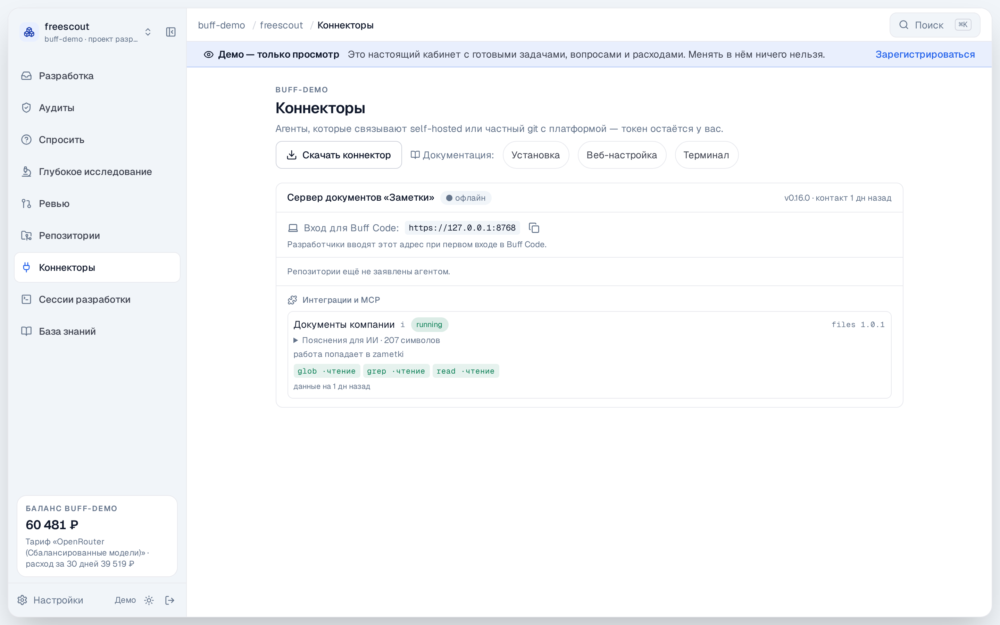
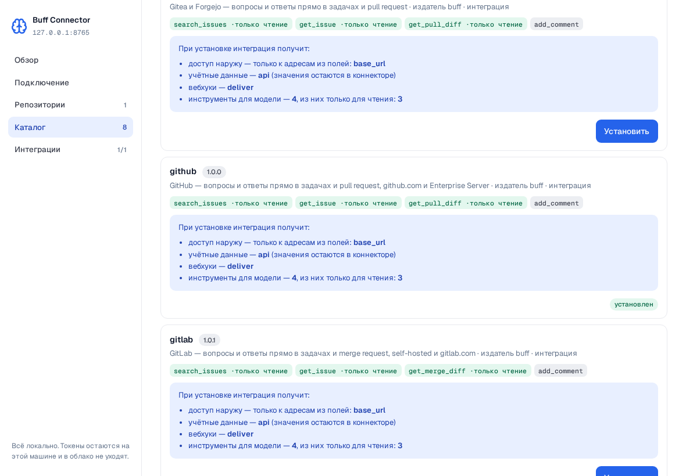
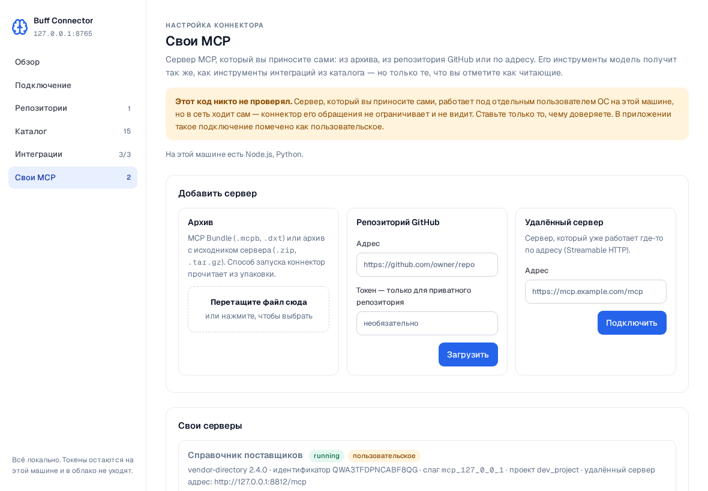

<p align="center">
  <picture>
    <source media="(prefers-color-scheme: dark)" srcset="assets/logo-dark.svg">
    
  </picture>
</p>

<p align="center">
  <b>The Buff connector — an agent inside your perimeter.</b><br>
  Buff's AI agents work with your code, trackers and documents, while your content, keys and intellectual property stay with you.
</p>

<p align="center">
  <a href="https://github.com/buffsystems/buff-connector/releases"></a>
  <a href="https://github.com/buffsystems/buff-connector/pkgs/container/buff-connector"></a>
  <a href="LICENSE"></a>
  <a href="https://buff.systems/en/docs/connector"></a>
</p>

<p align="center">
  <a href="#why-it-exists">Why</a> ·
  <a href="#what-it-does">What it does</a> ·
  <a href="#install">Install</a> ·
  <a href="#your-own-integrations-inside-the-perimeter">Your own integrations</a> ·
  <a href="#how-it-works">How it works</a> ·
  <a href="https://buff.systems/en/docs/connector">Documentation</a> ·
  <a href="README.md">Русский</a>
</p>

---

**Buff** turns a tracker issue into a tested branch, answers questions from company documents and writes in-depth research — with AI agents. To do that, the agents need your repositories, trackers and knowledge base. The **connector** gives them that access without taking out of your network what must stay in it: it runs on your side, reaches your systems from the inside, and sends out only an outbound connection and exactly what an answer needs.

The same connector serves every Buff edition — **Community, Enterprise on-premise and SaaS**. Its code is open: read all of it before you let the agent into your network.

## Why it exists

| | |
|---|---|
| **Keys never leave the perimeter** | Tokens for git providers, trackers and wikis, and the agent's own key, live only on the connector's machine. Even integrations do not see them: the connector core builds the authenticated request and attaches the credentials itself. |
| **Content on demand, read-only** | The model gets only tools marked as read-only; it cannot write to your systems. An answer goes back to the ticket through the connector, on the platform's command — not through a model tool. |
| **Nothing opens inwards** | Outbound connections only: nothing connects into your network, tracker events are polled — no inbound port needed (a few webhooks are the exception, [see the docs](https://buff.systems/en/docs/connector/trackers)). |
| **Your integrations without handing over intellectual property** | Internal systems are plugged in with your own MCP server or an SDK plugin. The code runs on the connector's machine and goes nowhere — the model sees tool descriptions and call results only. |
| **Git servers behind a firewall** | The git bridge carries repositories that the internet cannot reach, and brings pull requests back — without exposing your git. |
| **Buff Code through the company** | The developer gateway: engineers' [Buff Code](https://github.com/buffsystems/buff-code) works with the organisation's models, knowledge and connections through the connector — no provider keys on developer machines. |

## Editions

| | Where the connector runs | What you get |
|---|---|---|
| **Community** | built into the installation on your machine | git providers and knowledge sources, tokens in a file next to the installation |
| **Enterprise on-premise** | inside your perimeter, next to the installation | every system of the perimeter, with no data crossing its border |
| **SaaS** | in your network | cloud Buff works with your systems, while keys and network access stay with you |

## What it does

| | |
|---|---|
| **Git bridge** | GitHub, GitLab, Gitea/Forgejo, Bitbucket — cloud and self-hosted, including behind a firewall. |
| **Issue trackers** | Jira (Server/DC and Cloud), GitLab, GitHub, Gitea, Redmine, Bitbucket: issues and discussions become sources for answers; the answer goes back to the same ticket. |
| **Knowledge sources** | Confluence, Notion, Google Drive, Figma, folders and network shares (SMB), the web. |
| **Your own MCP servers** | An archive, a GitHub repository or a remote server — with your explicit consent and marked «custom». |
| **Integration catalogue** | Signed bundles: before installing you see where an integration may connect, which credentials it asks for and which tools it gives the model. |
| **Isolation** | Every connection is a separate process under a separate OS user; neighbours cannot see each other, secrets are read by the core only. |

<p align="center">
  
  
</p>

## Install

**Community** needs nothing — the connector is built into the [installation](https://github.com/buffsystems/buff-community). For Enterprise and SaaS — a binary or an image.

**Binary** for Linux, macOS and Windows, in this repository's [releases](https://github.com/buffsystems/buff-connector/releases). Download it with the sums and the signature and verify them **before** running it — the public key [`cosign.pub`](cosign.pub) is right here in the repository:

```sh
B=https://github.com/buffsystems/buff-connector/releases/latest/download
curl -fLO $B/connector-linux-amd64 -fLO $B/connector-linux-amd64.sig -fLO $B/SHA256SUMS
curl -fLO https://raw.githubusercontent.com/buffsystems/buff-connector/main/cosign.pub
sha256sum -c SHA256SUMS --ignore-missing
cosign verify-blob --key cosign.pub \
  --signature connector-linux-amd64.sig connector-linux-amd64
chmod +x connector-linux-amd64 && sudo mv connector-linux-amd64 /usr/local/bin/connector
connector pair --config /etc/connector/connector.yaml --code <code from the app>
connector run  --config /etc/connector/connector.yaml
```

**Docker** (amd64/arm64, `git` included):

```sh
docker run -d --name buff-connector \
  -v /srv/connector:/etc/connector \
  -v buff-connector-state:/var/lib/connector \
  ghcr.io/buffsystems/buff-connector:latest
```

Mirrors: `registry.buff.systems/buff/connector` for the image and [buff.systems/en/downloads](https://buff.systems/en/downloads) for the files. The pairing code comes from the Buff app, section «Connectors»; the rest is set up on the agent's local page. Details: [Install](https://buff.systems/en/docs/connector/install) and [Local page](https://buff.systems/en/docs/connector/web-setup).

**Language.** The command line and the local page speak Russian and English. The language comes from the system — `LANGUAGE`, `LC_ALL`, `LC_MESSAGES`, `LANG` (for the page, the browser's languages); when none of them names Russian or English, it is Russian. To set it explicitly: `--lang en` or `BUFF_LANG=en`, and on the page the switch in the header.

The model reads the tools in the language of the work, not the connector's: a Buff run names its language in the request (`lang` in `mcp/list` and `mcp/call`), Buff Code in the `X-Buff-Lang` header, and the tools' descriptions, answers and refusals come in it. A caller that names none gets the connector's language.

## Your own integrations inside the perimeter

An internal system that is not in the catalogue is plugged in without handing its code or data to us:

- **Your own MCP server** — your vendor's, an open-source one or one your team wrote. Drop an archive (`.mcpb`, Node.js, Python), name a GitHub repository or the address of a remote server on the connector's local page. You decide which of its tools count as read-only. [More](https://buff.systems/en/docs/connector/custom-mcp).
- **An SDK plugin** — [`sdk/buff_plugin`](sdk/buff_plugin), Python standard library only: a plugin is an MCP server that holds no credentials and asks the connector to make requests on its behalf; the connector attaches the key, checks the address against the allowlist and journals the call. The English of its catalogue card and settings form sits beside the manifest, in `manifest.en.yaml`. What the model reads — each tool's description and its parameters' — is in `tools.ru.md` and `tools.en.md`: `# tool`, its text below, `## parameter` and its text; adjacent lines join with a space, a blank line starts a new line, `{{name}}` is a value the plugin fills in (`fill`). Publishing refuses a plugin with a tool or a parameter described in one language only. A plugin writes its answers and refusals through `say(ru, en)` — in the call's language.

The integration's code stays on the connector's machine. What reaches the model is tool descriptions and call results — exactly what an answer needs.

<p align="center">
  
</p>

## How it works

```
        your network                             │        Buff
                                                 │
 your git ◀──local──┐                            │
                    │                            │
 tracker, wiki ◀────┤   CONNECTOR                │
                    ├── core: git bridge ────────┼──outbound──▶ Buff platform
 your MCP server ◀──┘   integrations: own uid,   │              (CE · EE · SaaS)
                        own allowed addresses    │
```

- **A small core that is only the git bridge** — readable end to end; it does not grow with each new integration.
- **Integrations are signed bundles** from the catalogue; the public key is built into the binary, the signature is checked before unpacking.
- **The catalogue lives in a container registry** — a closed perimeter mirrors it into its own Harbor or Nexus and changes only the address.
- **Releases are signed** with cosign, the signature is in the public transparency log.

Details: [Isolation and access boundaries](https://buff.systems/en/docs/connector/isolation) and [Tools and the model](https://buff.systems/en/docs/connector/tools).

## Building from source

Go 1.22+.

```sh
make test     # unit tests
make vet
make build    # a binary for your system
make dist     # every platform into dist/ with SHA256SUMS
```

## Contributing and licence

Bugs and proposals — via [issues](https://github.com/buffsystems/buff-connector/issues), changes — via pull request; the rules are in [CONTRIBUTING.en.md](CONTRIBUTING.en.md) (including work with AI assistants). The repository is published as one snapshot per Buff release: accepted changes ship in the next one.

Licence — [MIT](LICENSE). The libraries vendored into the files plugin (pypdf, pyasn1, pysmb) keep their own licences, next to their code.
